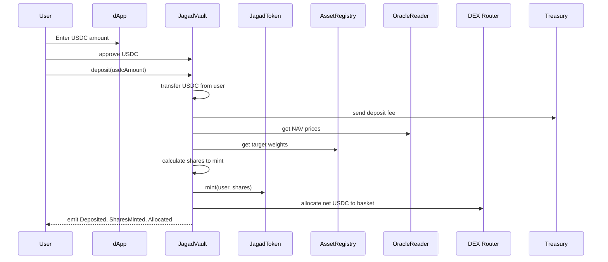
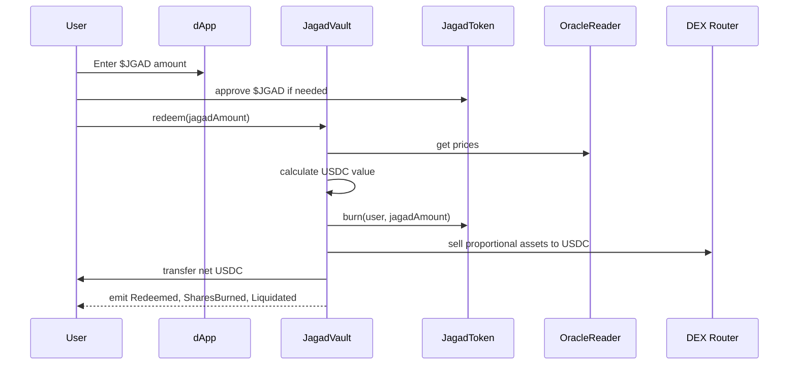
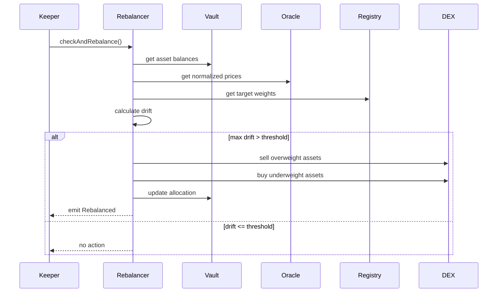
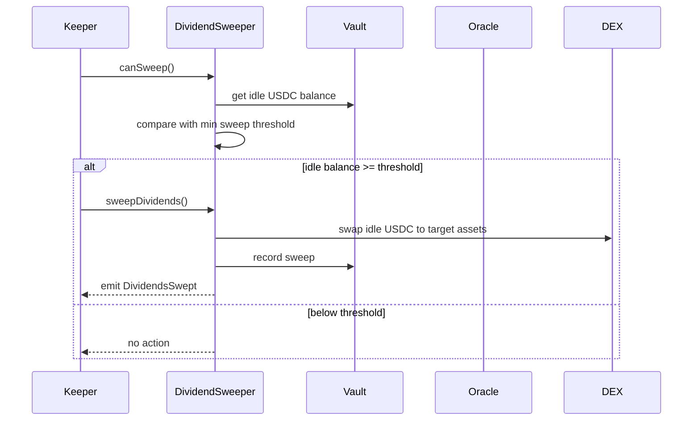

# Technical Architecture Document: JAGAD Vault

| Field | Value |
|---|---|
| Product Name | JAGAD |
| Token Ticker | $JGAD |
| Version | 0.1.0 |
| Status | Draft |
| Date | Oktober 2026 |
| Owner | Mufti Zaka / Founder JAGAD |
| Related Document | PRD.md |
| Document Type | Technical Architecture |

---

## 1. Purpose

Dokumen ini menjelaskan **bagaimana JAGAD dibangun secara teknis**.

Kalau `PRD.md` menjawab:

- WHAT: produk apa yang dibangun?
- WHY: kenapa produk ini dibutuhkan?

Maka `ARCHITECTURE.md` menjawab:

- HOW: sistemnya gimana cara kerjanya?
- WITH WHAT: tech stack, kontrak, oracle, DEX, automation, dan testing strategy-nya apa?

Arsitektur ini dirancang untuk MVP JAGAD v1.0 sesuai PRD:

- Single-chain deployment di Base.
- Deposit/redeem USDC.
- Multi-asset vault basket.
- Automatic allocation.
- Threshold-based rebalancing.
- Dividend/yield sweep.
- Oracle-backed NAV.
- Multisig admin control.
- Pause mechanism.
- Foundry testing.

---

## 2. Architecture Principles

### 2.1 Security First

JAGAD menyimpan aset pengguna. Karena itu, arsitektur harus mengutamakan:

- aset disimpan di contract vault, bukan wallet admin;
- semua fungsi privileged dilindungi access control;
- oracle harus divalidasi freshness dan outlier;
- rebalancing dan sweep harus punya slippage protection;
- vault harus bisa di-pause saat terjadi anomali;
- invariant solvabilitas harus selalu terjaga.

### 2.2 Modularity

Sistem dipecah menjadi modul-modul kecil supaya mudah diuji dan tidak ada satu kontrak raksasa yang sulit diaudit.

Modul utama:

- Token vault share: `JagadToken`
- Core vault: `JagadVault`
- Rebalancing: `Rebalancer`
- Dividend sweep: `DividendSweeper`
- Oracle reading: `OracleReader`
- Treasury/fee: `Treasury`
- Asset registry: `AssetRegistry`

### 2.3 Deterministic Accounting

NAV, bobot aset, drift, fee, dan hasil swap harus bisa dihitung ulang secara on-chain atau melalui indexer.

Semua aksi penting harus memancarkan event:

- deposit;
- redeem;
- mint;
- burn;
- rebalance;
- dividend sweep;
- parameter update;
- pause/unpause.

### 2.4 Gas Efficiency

Karena JAGAD melakukan swap otomatis, arsitektur harus menghindari operasi yang boros gas tanpa manfaat.

Prinsip:

- rebalance hanya jika drift > threshold;
- sweep hanya jika idle yield > minimum threshold;
- ada cooldown antar rebalance;
- ada max slippage;
- menggunakan Layer 2 Base untuk menekan gas fee.

### 2.5 Upgradeability with Control

MVP menggunakan pola upgradeable yang aman supaya bug kritis bisa diperbaiki tanpa migrasi manual yang berisiko.

Keputusan:

- `JagadVault` menggunakan UUPS upgradeable pattern.
- Upgrade hanya bisa dilakukan oleh TimelockController yang dikontrol multisig.
- Storage layout harus aman menggunakan storage gap.
- `JagadToken` sebaiknya immutable setelah deploy, kecuali ada alasan kuat untuk upgradeable.

---

## 3. High-Level System Context

```mermaid
flowchart LR
    User([User Wallet]) -->|Deposit USDC| dApp[JAGAD dApp]
    dApp -->|deposit()| Vault[JagadVault]
    Vault -->|mint| Token[$JGAD Token]
    Vault -->|swap| DEX[DEX Router / Aggregator]
    Vault -->|read price| Oracle[OracleReader]
    Oracle --> Chainlink[Chainlink Feeds]
    Oracle --> Pyth[Pyth Cross-check]

    Keeper[Chainlink Automation / Gelato] -->|rebalance()| Rebalancer[Rebalancer]
    Keeper -->|sweepDividends()| Sweeper[DividendSweeper]
    Rebalancer --> Vault
    Sweeper --> Vault

    Admin([Multisig Safe]) --> Timelock[TimelockController]
    Timelock --> Vault
    Timelock --> AssetRegistry[AssetRegistry]
    Timelock --> Treasury[Treasury]

    Vault --> Events[On-chain Events]
    Events --> Subgraph[Indexer / Dashboard]
```

---

## 4. Blockchain and Network Choice

### Primary Network

**Base Mainnet**

Alasan:

- EVM compatible.
- Gas fee rendah dibanding Ethereum L1.
- Ekosistem DeFi dan RWA berkembang.
- Akses ke DEX seperti Aerodrome dan Uniswap.
- Support oracle mainstream.

### Test Network

**Base Sepolia**

Digunakan untuk:

- deploy kontrak;
- simulasi deposit/redeem;
- test rebalancing;
- test dividend sweep;
- test oracle failure;
- dry run frontend.

### Alternative Network

**Arbitrum One**

Dipertimbangkan jika:

- aset RWA tertentu lebih likuid di Arbitrum;
- integrasi oracle/DEX lebih stabil;
- kebutuhan institusional lebih cocok di Arbitrum.

Untuk MVP, satu jaringan dulu. Multi-chain keluar dari scope.

---

## 5. Tech Stack

### 5.1 Smart Contract Stack

| Component | Technology | Reason |
|---|---|---|
| Language | Solidity ^0.8.26 | Standar modern, built-in overflow protection. |
| Framework | Foundry | Fast testing, fuzzing, invariant testing, cheatcodes. |
| Token Standard | ERC-20 | Kompatibel wallet, DEX, dashboard. |
| Vault Pattern | ERC-4626-inspired custom vault | Standar vault share, tapi perlu fleksibilitas multi-aset. |
| Security Library | OpenZeppelin Contracts | AccessControl, Pausable, ReentrancyGuard, UUPS, SafeERC20. |
| Upgradeability | UUPS Proxy | Controlled upgrades via timelock. |
| Math | Fixed-point WAD / BPS | Hindari floating point, gunakan integer math. |

### 5.2 Oracle Stack

| Component | Technology | Reason |
|---|---|---|
| Primary Oracle | Chainlink Data Feeds | Standar industri, luas didukung. |
| Secondary Oracle | Pyth Network | Cross-check harga, mengurangi single oracle risk. |
| Price Validation | Custom OracleReader | Freshness check, deviation check, stale rejection. |

### 5.3 DEX / Swap Stack

| Component | Technology | Reason |
|---|---|---|
| Primary Router | 1inch Fusion / Router | Aggregasi likuiditas, mengurangi slippage. |
| Secondary Router | Uniswap Universal Router | Fallback jika 1inch unavailable. |
| Base-native DEX | Aerodrome | Likuiditas lokal Base. |
| Slippage Control | minAmountOut / maxAmountIn | Proteksi terhadap price impact dan sandwich attack. |

### 5.4 Automation Stack

| Component | Technology | Reason |
|---|---|---|
| Keeper | Chainlink Automation | Terintegrasi dengan oracle ecosystem. |
| Alternative Keeper | Gelato Network | Fleksibel untuk custom check logic. |

### 5.5 Frontend Stack

| Component | Technology | Reason |
|---|---|---|
| Framework | Next.js | SSR/SSG, ekosistem React成熟. |
| Language | TypeScript | Type safety. |
| Web3 Library | Wagmi + Viem | Modern Ethereum interaction. |
| Wallet Connection | RainbowKit / ConnectKit | UX wallet cepat. |
| Styling | Tailwind CSS | Cepat dan konsisten. |
| Charts | Recharts / Visx | Visualisasi NAV dan alokasi. |

### 5.6 Indexing / Analytics

| Component | Technology | Reason |
|---|---|---|
| MVP | Direct RPC reads via Viem | Simple, cukup untuk dashboard minimal. |
| Later | The Graph subgraph | Query history lebih cepat dan scalable. |
| Optional | Custom indexer | Untuk rebalance/sweep analytics lanjutan. |

---

## 6. Repository Structure

```text
jagad-vault/
├── PRD.md
├── ARCHITECTURE.md
├── TOKENOMICS.md
├── SECURITY.md
├── RUNBOOK.md
├── README.md
├── foundry.toml
├── .env.example
├── .github/
│   └── workflows/
│       ├── test.yml
│       ├── fuzz.yml
│       └── security.yml
├── script/
│   ├── Deploy.s.sol
│   ├── ConfigureAssets.s.sol
│   ├── ConfigureOracles.s.sol
│   └── Verify.s.sol
├── src/
│   ├── interfaces/
│   │   ├── IJagadVault.sol
│   │   ├── IRebalancer.sol
│   │   ├── IDividendSweeper.sol
│   │   ├── IOracleReader.sol
│   │   ├── IAssetRegistry.sol
│   │   └── ITreasury.sol
│   ├── libraries/
│   │   ├── RebalancerMath.sol
│   │   ├── NAVMath.sol
│   │   └── SafePrice.sol
│   ├── mocks/
│   │   ├── MockERC20.sol
│   │   ├── MockChainlinkAggregator.sol
│   │   ├── MockPyth.sol
│   │   └── MockDEXRouter.sol
│   ├── JagadToken.sol
│   ├── JagadVault.sol
│   ├── Rebalancer.sol
│   ├── DividendSweeper.sol
│   ├── OracleReader.sol
│   ├── AssetRegistry.sol
│   └── Treasury.sol
├── test/
│   ├── unit/
│   │   ├── JagadToken.t.sol
│   │   ├── JagadVault.deposit.t.sol
│   │   ├── JagadVault.redeem.t.sol
│   │   ├── Rebalancer.t.sol
│   │   ├── DividendSweeper.t.sol
│   │   └── OracleReader.t.sol
│   ├── integration/
│   │   ├── DepositToAllocation.t.sol
│   │   ├── RebalanceFlow.t.sol
│   │   ├── SweepFlow.t.sol
│   │   └── RedeemFlow.t.sol
│   ├── fuzz/
│   │   ├── MarketCrash.t.sol
│   │   ├── OracleManipulation.t.sol
│   │   └── SlippageAttack.t.sol
│   └── invariant/
│       ├── Solvency.t.sol
│       ├── WeightInvariant.t.sol
│       └── PauseInvariant.t.sol
└── deployments/
    ├── base-sepololia.json
    └── base-mainnet.json
```

---

## 7. Smart Contract Modules

### 7.1 `JagadToken.sol`

Token ERC-20 yang merepresentasikan kepemilikan share vault.

Responsibilities:

- Mint $JGAD saat user deposit.
- Burn $JGAD saat user redeem.
- Hanya `JagadVault` yang boleh mint/burn.
- Emit standard ERC-20 events.
- Optional: permit support untuk UX.

Key functions:

```solidity
function mint(address to, uint256 amount) external onlyVault;
function burn(address from, uint256 amount) external onlyVault;
```

Design decision:

- MVP: token immutable.
- Tidak ada tax, tidak ada rebase, tidak ada blacklist.
- Transferability penuh untuk aset crypto-native.
- Jika ada aset RWA whitelist, pembatasan dilakukan di level vault/asset adapter, bukan token $JGAD.

---

### 7.2 `JagadVault.sol`

Kontrak utama yang menyimpan aset underlying dan mengelola share accounting.

Responsibilities:

- Terima deposit USDC.
- Hitung NAV.
- Mint/burn $JGAD.
- Simpan aset basket.
- Panggil allocator/rebalancer.
- Enforce fee.
- Support pause.
- Emit events.
- Expose view functions untuk dashboard.

Core state:

```solidity
IERC20 public immutable usdc;
IJagadToken public immutable jagadToken;
IAssetRegistry public assetRegistry;
IOracleReader public oracleReader;
IRebalancer public rebalancer;
IDividendSweeper public dividendSweeper;
ITreasury public treasury;

uint256 public depositFeeBps;
uint256 public redeemFeeBps;
uint256 public managementFeeBps;
uint256 public driftThresholdBps;
uint256 public rebalanceCooldown;
uint256 public lastRebalanceTimestamp;
```

Key functions:

```solidity
function deposit(uint256 usdcAmount) external whenNotPaused returns (uint256 jagadAmount);
function redeem(uint256 jagadAmount) external whenNotPaused returns (uint256 usdcAmount);
function getNav() public view returns (uint256 totalValueWad, uint256 navPerShareWad);
function getTotalAssetsValue() public view returns (uint256);
function getAssetValue(address token) public view returns (uint256);
function pause() external onlyPauser;
function unpause() external onlyPauser;
```

Deposit flow:

1. User approve USDC ke vault.
2. Vault transfer USDC dari user.
3. Vault hitung deposit fee.
4. Vault kirim fee ke Treasury.
5. Vault hitung net deposit.
6. Vault hitung NAV sebelum alokasi.
7. Vault mint $JGAD berdasarkan net deposit / NAV per share.
8. Vault alokasikan net USDC ke basket melalui allocator/rebalancer.
9. Vault emit `Deposited` dan `SharesMinted`.

Redeem flow:

1. User transfer $JGAD ke vault.
2. Vault hitung underlying value berdasarkan NAV.
3. Vault hitung redeem fee.
4. Vault burn $JGAD.
5. Vault jual aset proporsional ke USDC.
6. Vault kirim net USDC ke user.
7. Vault emit `Redeemed` dan `SharesBurned`.

Important invariant:

```text
totalAssetsValue >= totalSharesValue
```

atau lebih tepatnya:

```text
sum(asset balances valued at oracle price) >= outstanding $JGAD supply * navPerShare
```

Karena NAV dihitung dari aset, invariant utama adalah vault tidak boleh berjanji lebih dari yang dimiliki.

---

### 7.3 `AssetRegistry.sol`

Menyimpan daftar aset yang boleh dipegang vault beserta metadata.

Responsibilities:

- Register asset token address.
- Set target weight.
- Set oracle feed.
- Enable/disable asset.
- Store decimals dan tier.
- Prevent duplicate assets.

Asset struct:

```solidity
struct AssetConfig {
    address token;
    uint8 decimals;
    uint256 targetWeightBps;
    address priceFeed;
    bool enabled;
    uint8 tier;
    uint256 minLiquidityUsd;
    bool isNumeraire;
}
```

Tier enum:

```solidity
enum Tier {
    BUNKER,
    ENGINE,
    GLOBAL_PROXY
}
```

Example initial config:

| Token | Tier | Target Weight |
|---|---|---:|
| USDC | BUNKER | 20% |
| PAXG | BUNKER | 15% |
| sSilver | BUNKER | 10% |
| WBTC | ENGINE | 25% |
| Energy Proxy | GLOBAL_PROXY | 10% |
| Mining Proxy | GLOBAL_PROXY | 10% |
| REIT Proxy | GLOBAL_PROXY | 5% |
| Agri Proxy | GLOBAL_PROXY | 5% |

Validation:

```solidity
require(sum(targetWeightBps) == 10_000, "Invalid weights");
```

---

### 7.4 `OracleReader.sol`

Wrapper untuk membaca dan memvalidasi harga.

Responsibilities:

- Baca harga dari Chainlink.
- Baca harga dari Pyth sebagai cross-check.
- Normalisasi decimals ke 18 digit.
- Tolak harga stale.
- Tolak harga outlier.
- Expose TWAP jika tersedia.

Key functions:

```solidity
function getNormalizedPrice(address feed) external view returns (uint256 priceWad);
function getNormalizedPriceWithSource(address feed) external view returns (uint256 priceWad, uint256 timestamp, uint8 source);
function validatePrice(address feed, uint256 price, uint256 timestamp) internal view returns (bool);
```

Freshness rule:

```text
block.timestamp - priceTimestamp <= maxStalenessSeconds
```

Default:

```text
maxStalenessSeconds = 3600
```

Cross-check rule:

```text
abs(chainlinkPrice - pythPrice) / chainlinkPrice <= maxOracleDeviationBps
```

Default:

```text
maxOracleDeviationBps = 200 // 2%
```

Jika deviation terlalu besar:

- revert untuk operasi kritis;
- atau trigger circuit breaker dan pause otomatis jika diimplementasikan.

---

### 7.5 `Rebalancer.sol`

Menjaga alokasi vault tetap dekat dengan target basket.

Responsibilities:

- Hitung current weight tiap aset.
- Hitung drift terhadap target weight.
- Tentukan apakah rebalance perlu dijalankan.
- Jual aset overweight.
- Beli aset underweight.
- Enforce slippage protection.
- Emit rebalance events.

Math library:

`RebalancerMath.sol`

```solidity
function calculateDriftBps(
    uint256 currentValue,
    uint256 totalValue,
    uint256 targetWeightBps
) internal pure returns (int256 driftBps);
```

Formula:

```text
currentWeightBps = currentValue * 10_000 / totalValue
driftBps = currentWeightBps - targetWeightBps
```

Trigger:

```text
abs(driftBps) > driftThresholdBps
```

Default:

```text
driftThresholdBps = 500 // 5%
```

Rebalance execution:

1. Ambil semua harga dari OracleReader.
2. Hitung nilai tiap aset.
3. Hitung total vault value.
4. Hitung target value tiap aset.
5. Hitung delta:
   - delta > 0: overweight, perlu dijual.
   - delta < 0: underweight, perlu dibeli.
6. Jual aset overweight ke USDC.
7. Beli aset underweight memakai USDC hasil penjualan.
8. Cek post-rebalance deviation.
9. Emit event.

Safety rules:

- Tidak boleh rebalance saat paused.
- Tidak boleh rebalance jika oracle stale.
- Tidak boleh rebalance jika cooldown belum lewat.
- Tidak boleh rebalance jika estimated gas cost > benefit.
- Setiap swap harus punya `minAmountOut`.
- Tidak boleh menjual aset di bawah `minLiquidityUsd` tanpa override multisig.

---

### 7.6 `DividendSweeper.sol`

Mengompounding yield/dividen yang mengendap di vault.

Responsibilities:

- Deteksi idle USDC/DAI hasil dividen/yield.
- Jalankan sweep jika balance melebihi threshold.
- Reinvest ke target aset.
- Emit sweep events.
- Jaga agar sweep tidak mengganggu solvabilitas.

Default reinvestment split:

| Destination | Split |
|---|---:|
| Tier 1 | 60% |
| Tier 2 | 30% |
| Tier 3 | 10% |

Alternative aggressive split:

| Destination | Split |
|---|---:|
| Tier 1 | 50% |
| Tier 2 | 30% |
| Tier 3 | 20% |

Parameter ini bisa diubah oleh multisig.

Minimum sweep threshold:

```text
default = $1,000 equivalent USDC
```

Logic:

1. Keeper panggil `canSweep()`.
2. Contract cek idle balance.
3. Jika idle balance < threshold, return false.
4. Jika true, keeper panggil `sweepDividends()`.
5. Contract swap idle USDC ke target aset sesuai split.
6. Emit `DividendsSwept`.

Accounting note:

Karena sulit membedakan secara on-chain apakah USDC berasal dari principal atau dividen, MVP menggunakan pendekatan:

```text
idleUsdcForSweep = usdcBalance - operatingReserve
```

`operatingReserve` adalah USDC minimum yang disimpan untuk fee, gas, dan redeem normal.

---

### 7.7 `Treasury.sol`

Mengelola fee dan reserve operasional.

Responsibilities:

- Terima deposit fee.
- Terima redeem fee.
- Terima management fee jika diimplementasikan.
- Menyimpan gas reserve.
- Membatasi withdrawal treasury.
- Emit fee events.

Fee destinations:

| Fee Type | Destination |
|---|---|
| Deposit fee | Treasury / gas reserve |
| Redeem fee | Treasury / gas reserve |
| Management fee | Treasury |
| Yield surplus | Gas reserve / protocol revenue |

Safety:

- Treasury withdrawal hanya oleh multisig.
- Ada cap withdrawal per periode.
- Tidak boleh withdraw saat vault paused kecuali emergency procedure.

---

## 8. Data Model and Units

### 8.1 Decimal Convention

Semua perhitungan internal menggunakan 18 decimals.

```solidity
uint256 constant WAD = 1e18;
uint256 constant BPS_BASE = 10_000;
```

Token external bisa punya decimals berbeda, misalnya:

- USDC: 6 decimals.
- WBTC: 8 decimals.
- PAXG: 18 decimals.
- Some RWA tokens: custom decimals.

Maka semua balance dan harga dinormalisasi ke WAD sebelum dihitung.

### 8.2 Price Representation

Harga aset dinyatakan sebagai USD per token dalam 18 decimals.

Contoh:

```text
PAXG price = $2,700 per token
priceWad = 2,700 * 1e18
```

### 8.3 Asset Value Formula

```text
assetValueWad = tokenBalance * priceWad / 10 ** tokenDecimals
```

### 8.4 Total Vault Value

```text
totalVaultValueWad = sum(assetValueWad for all enabled assets)
```

### 8.5 NAV Per Share

```text
navPerShareWad = totalVaultValueWad * WAD / totalJagadSupply
```

Jika `totalJagadSupply == 0`, maka:

```text
navPerShareWad = WAD
```

artinya 1 $JGAD = 1 USD equivalent saat vault kosong.

---

## 9. Core Flows

### 9.1 Deposit Flow



Acceptance criteria:

- User menerima $JGAD.
- Vault memegang kombinasi aset sesuai target dalam toleransi.
- Fee tercatat.
- Event teremit.
- Jika swap gagal, deposit harus revert atau memiliki mekanisme refund yang aman.

Recommended MVP behavior:

- Deposit dan allocation atomic.
- Jika allocation gagal, seluruh transaksi revert.
- Tidak ada partial deposit yang tertinggal tanpa share.

---

### 9.2 Redeem Flow



Acceptance criteria:

- $JGAD dibakar.
- Aset dijual proporsional.
- User menerima USDC setelah fee.
- Vault tetap solvent.
- Jika likuiditas tidak cukup, redeem revert dengan error jelas.

---

### 9.3 Rebalancing Flow



Trigger condition:

```solidity
if (
    !paused &&
    block.timestamp >= lastRebalanceTimestamp + cooldown &&
    maxAbsDriftBps > driftThresholdBps &&
    oraclePricesValid
) {
    executeRebalance();
}
```

Post-condition:

```text
setelah rebalance sukses, maxAbsDriftBps <= driftThresholdBps + allowedSlippageTolerance
```

---

### 9.4 Dividend Sweep Flow



Purpose:

- Yield/dividen tidak menganggur.
- NAV vault meningkat secara organik.
- Gas fee tidak dimakan oleh sweep recehan.

---

## 10. Asset Adapter Pattern

Beberapa aset mungkin tidak bisa diperlakukan sama seperti ERC-20 biasa.

Contoh:

- tokenized stock mungkin whitelist-only;
- synthetic asset mungkin punya mint/burn khusus;
- REIT token mungkin punya transfer restriction;
- some RWA tokens mungkin tidak listing di DEX publik.

Maka arsitektur mendukung `IAssetAdapter`.

```solidity
interface IAssetAdapter {
    function balanceOf(address assetOwner, address token) external view returns (uint256);
    function swapToNumeraire(address token, uint256 amount, uint256 minOut) external returns (uint256);
    function swapFromNumeraire(address token, uint256 usdcAmount, uint256 minOut) external returns (uint256);
    function isTransferRestricted(address from, address to) external view returns (bool);
}
```

Untuk MVP crypto-native:

- gunakan `StandardERC20Adapter`.

Untuk RWA terbatas:

- gunakan `WhitelistedRWAAdapter`.
- vault hanya boleh hold jika address vault sudah whitelist.
- redeem mungkin perlu delay atau partial liquidity.

Keputusan MVP:

- Tier 1 dan Tier 2 memakai standard adapter.
- Tier 3 memakai adapter yang tergantung ketersediaan aset:
  - jika synthetic/liquid: standard adapter;
  - jika RWA whitelist: restricted adapter;
  - jika tidak cukup likuid: bobot diturunkan atau asset disabled.

---

## 11. Access Control Model

### Roles

| Role | Holder | Permission |
|---|---|---|
| DEFAULT_ADMIN_ROLE | TimelockController | Ultimate admin. |
| PAUSER_ROLE | Security council / multisig | Pause/unpause vault. |
| KEEPER_ROLE | Chainlink Automation / Gelato | Call rebalance/sweep. |
| PARAM_MANAGER_ROLE | TimelockController | Update weights, fees, thresholds. |
| TREASURY_ROLE | Treasury contract / multisig | Withdraw protocol fees. |
| ASSET_MANAGER_ROLE | TimelockController | Register/update assets. |

### Admin Structure

```text
Multisig Safe
    └── TimelockController
            └── Contract roles
```

Tidak ada single EOA yang bisa:

- upgrade contract;
- mengubah target weight;
- menarik treasury;
- pause/unpause tanpa kontrol.

Emergency pause bisa diberikan ke security council dengan role terpisah, tapi harus ada event dan time-bound review.

---

## 12. Upgradeability Design

### Recommended Pattern

UUPS Upgradeable untuk `JagadVault`.

Reason:

- Gas efficient dibanding Transparent Proxy.
- kompatibel dengan OpenZeppelin.
- bisa dikombinasikan dengan AccessControl dan Timelock.

Rules:

- Constructor tidak boleh initalize state.
- Gunakan `initializer` modifier.
- Storage layout harus reserved gap.
- Upgrade hanya lewat timelock.
- Setiap upgrade emit event.
- Upgrade harus di-test di testnet terlebih dahulu.

Storage gap example:

```solidity
uint256[50] private __gap;
```

### Immutable Components

- `JagadToken` sebaiknya immutable.
- `AssetRegistry` bisa upgradeable jika perlu menambah fitur adapter.
- `OracleReader` bisa upgradeable karena integrasi oracle bisa berubah.

---

## 13. Security Invariants

Invariant adalah kondisi yang harus selalu benar.

### INV-1: Solvency

```text
totalVaultValue >= totalLiabilities
```

Untuk MVP tanpa borrowing:

```text
totalVaultValue >= 0
```

dan semua share mewakili klaim atas aset yang ada.

Lebih ketat:

```text
sum(asset balances) dapat dicairkan ke USDC >= redeem obligations pada NAV saat ini
```

### INV-2: Weight Sum

```text
sum(enabled asset targetWeightBps) == 10_000
```

### INV-3: No Unauthorized Mint/Burn

```text
only JagadVault can mint/burn JagadToken
```

### INV-4: Pause Blocks Economic Actions

Saat paused:

- deposit revert;
- redeem revert;
- rebalance revert;
- sweep revert;
- treasury withdrawal revert kecuali emergency function.

### INV-5: Oracle Freshness

Tidak ada operasi harga yang memakai feed dengan:

```text
timestamp < block.timestamp - maxStalenessSeconds
```

### INV-6: Slippage Protection

Setiap swap harus memiliki batas minimum output atau maksimum input.

```text
amountOut >= minAmountOut
```

atau:

```text
amountIn <= maxAmountIn
```

### INV-7: Rebalance Cooldown

```text
block.timestamp >= lastRebalanceTimestamp + rebalanceCooldown
```

### INV-8: Sweep Threshold

```text
idleUsdc >= minSweepAmount
```

---

## 14. Threat Model

### 14.1 Oracle Manipulation

Threat:

- Hacker memanipulasi harga spot untuk membuat vault salah hitung NAV.

Mitigation:

- Gunakan Chainlink sebagai primary.
- Cross-check dengan Pyth.
- Reject stale price.
- Reject deviation terlalu besar.
- Gunakan TWAP untuk operasi besar jika tersedia.
- Rebalance tidak boleh dijalankan jika oracle invalid.

### 14.2 Sandwich Attack

Threat:

- MEV bot melihat rebalance/swap besar dan menggeser harga.

Mitigation:

- Gunakan DEX aggregator.
- Enforce max slippage.
- Pecah order besar jika memungkinkan.
- Jalankan rebalance saat likuiditas cukup.
- Consider private transaction / Flashbots Protect untuk keeper.

### 14.3 Low Liquidity Redeem

Threat:

- User redeem besar saat aset Tier 3 tidak likuid.

Mitigation:

- Min liquidity check per asset.
- Redeem queue jika perlu di versi后续.
- Batasi max redeem per blok/hari.
- Tier 3 bobot kecil.
- Fallback ke synthetic/proxy yang lebih likuid.

### 14.4 Smart Contract Exploit

Threat:

- Bug di rebalancing, fee, mint/burn, atau upgrade logic.

Mitigation:

- OpenZeppelin standards.
- ReentrancyGuard.
- Checks-Effects-Interactions.
- Foundry fuzz/invariant tests.
- Internal audit.
- External audit sebelum TVL besar.
- Multisig + timelock.
- Pause mechanism.

### 14.5 Admin Key Compromise

Threat:

- Private key admin bocor.

Mitigation:

- Admin harus multisig.
- Privileged actions lewat timelock.
- Role separation.
- Emergency pause oleh council berbeda.

### 14.6 RWA Legal/Transfer Restriction

Threat:

- Tokenized stock/REIT tidak bisa ditransfer bebas ke vault atau user.

Mitigation:

- Asset adapter whitelist.
- Legal review sebelum enable asset.
- MVP prioritaskan aset crypto-native/synthetic.
- Pisahkan institutional KYC vault jika diperlukan.

---

## 15. Testing Strategy

### 15.1 Unit Tests

Target:

- Setiap fungsi kontrak diuji terisolasi.

Cases:

- deposit success;
- deposit fail when paused;
- deposit fail insufficient allowance;
- redeem success;
- redeem fail insufficient balance;
- mint only vault;
- burn only vault;
- fee calculation;
- NAV calculation;
- asset registry validation;
- oracle freshness rejection.

### 15.2 Integration Tests

Target:

- Kontrak saling berbicara dengan benar.

Cases:

- deposit -> allocation -> NAV update;
- rebalance trigger -> swap -> weight restored;
- dividend sweep -> asset purchase -> NAV increase;
- redeem -> liquidation -> USDC transfer;
- pause -> all economic actions blocked;
- upgrade -> storage preserved.

### 15.3 Fuzz Tests

Target:

- Cari edge case acak.

Parameters:

- random deposit amounts;
- random price movements;
- random oracle timestamps;
- random slippage;
- random asset weights;
- random keeper call timing.

Scenarios:

- BTC crash 50%;
- gold spike 30%;
- silver oracle deviation;
- multiple deposits/redeems in one block;
- rebalance during low liquidity;
- sweep with zero idle balance.

### 15.4 Invariant Tests

Target:

- Pastikan kondisi fundamental tidak pernah violation.

Invariants:

```text
sum(targetWeights) == 10_000
totalSupply == 0 => navPerShare == WAD
paused => no deposit/redeem/rebalance/sweep
oracle stale => no price-dependent action
after successful rebalance => drift within tolerance
treasury withdrawal <= allowed cap
```

### 15.5 Static Analysis

Tools:

- Slither.
- Foundry `forge build --sizes`.
- Custom lint.

Checks:

- unchecked external calls;
- reentrancy patterns;
- integer overflow impossible due to Solidity 0.8, but unsafe casting checked;
- unused state variables;
- visibility issues.

### 15.6 CI Pipeline

GitHub Actions:

```yaml
name: CI

on:
  pull_request:
  push:
    branches: [main]

jobs:
  test:
    runs-on: ubuntu-latest
    steps:
      - uses: actions/checkout@v4
      - uses: foundry-rs/foundry-toolchain@v1
      - run: forge submodule update --init --recursive
      - run: forge build
      - run: forge test
      - run: forge test --fuzz-runs 10000
      - run: forge fmt --check
```

---

## 16. Deployment Architecture

### 16.1 Local / Anvil

Used for:

- rapid iteration;
- mock assets;
- mock oracles;
- mock DEX.

### 16.2 Base Sepolia

Used for:

- end-to-end testnet deployment;
- frontend integration;
- keeper dry run;
- oracle configuration;
- user acceptance testing.

Deployment order:

1. Deploy mock/real ERC20 assets if available.
2. Deploy `JagadToken`.
3. Deploy `AssetRegistry`.
4. Deploy `OracleReader`.
5. Deploy `Treasury`.
6. Deploy `Rebalancer`.
7. Deploy `DividendSweeper`.
8. Deploy `JagadVault` implementation.
9. Deploy proxy and initialize vault.
10. Grant roles.
11. Register assets.
12. Configure fees and thresholds.
13. Fund gas reserve.
14. Activate keeper.
15. Run smoke tests.

### 16.3 Base Mainnet Soft Launch

Constraints:

- TVL cap awal.
- Whitelist user opsional.
- Keeper aktif tapi dengan parameter konservatif.
- Dividend sweep bisa ditunda sampai stabil.
- Monitoring ketat.

Soft launch checklist:

- multisig configured;
- timelock configured;
- contracts verified;
- oracle feeds live;
- DEX liquidity available;
- frontend connected to mainnet;
- alerting configured;
- runbook ready.

---

## 17. Monitoring and Observability

### On-chain Events to Monitor

- `Deposited`
- `Redeemed`
- `Rebalanced`
- `DividendsSwept`
- `Paused`
- `Unpaused`
- `ParameterUpdated`
- `Upgraded`

### Dashboard Metrics

| Metric | Source |
|---|---|
| Total TVL | Vault balances * oracle prices |
| NAV per $JGAD | Vault view function |
| Current allocation | Asset balances |
| Drift per asset | Rebalancer math |
| Last rebalance time | Vault storage/event |
| Idle yield balance | Treasury/vault accounting |
| Fee revenue | Treasury events |
| Oracle freshness | OracleReader events/view |

### Alert Conditions

Alert jika:

- oracle stale > threshold;
- deviation antar oracle > threshold;
- rebalance gagal berulang;
- sweep gagal berulang;
- TVL drop tajam;
- redeem queue/backlog tinggi;
- admin role changed;
- contract upgraded;
- pause activated.

---

## 18. Frontend Architecture

### Pages

| Page | Purpose |
|---|---|
| Landing | Explain JAGAD, disclaimer, CTA. |
| Dashboard | NAV, allocation, history. |
| Deposit | Connect wallet, approve USDC, deposit. |
| Redeem | Enter $JGAD amount, preview USDC, redeem. |
| Vault Details | Asset breakdown, fees, rebalance history. |
| Risk Center | Disclaimer, oracle status, pause status. |

### State Management

- Wallet state: RainbowKit/ConnectKit.
- Contract state: Wagmi hooks.
- UI state: React state / Zustand if needed.

### Critical UX Requirements

- Tampilkan estimasi fee sebelum transaksi.
- Tampilkan warning bahwa $JGAD bukan stablecoin USD.
- Tampilkan oracle status.
- Tampilkan apakah vault paused.
- Tampilkan projected allocation setelah deposit.
- Tampilkan estimated slippage jika tersedia.

---

## 19. Indexer / Subgraph Design

Untuk MVP, direct RPC bisa cukup. Tapi struktur event harus siap di-index.

Entities:

```text
Vault
Asset
Deposit
Redeem
Rebalance
DividendSweep
ParameterUpdate
PauseEvent
```

Example `Rebalance` entity:

```text
id
timestamp
txHash
assetSold
amountSold
assetBought
amountBought
preDriftBps
postDriftBps
gasUsed
slippageBps
```

This enables dashboard history tanpa recomputing semua transaksi dari awal.

---

## 20. Fee Architecture

### Fee Types

| Fee | Default | Collection Point | Destination |
|---|---:|---|---|
| Deposit fee | 0.4% | Saat deposit | Treasury / gas reserve |
| Redeem fee | 0.4% | Saat redeem | Treasury / gas reserve |
| Management fee | 0% MVP / configurable | Accrued daily atau dari yield | Treasury |
| Rebalancing reserve | dari yield/fee | Keeper gas payment | Gas reserve |

### Fee Safety

- Fee tidak boleh membuat vault insolvent.
- Fee withdrawal harus capped.
- Fee parameter change harus lewat timelock.
- Saat paused, fee withdrawal diblokir kecuali emergency.

---

## 21. Configuration Parameters

All parameters should be stored on-chain and updatable by governance/timelock.

| Parameter | Default | Description |
|---|---:|---|
| `depositFeeBps` | 40 | 0.4% |
| `redeemFeeBps` | 40 | 0.4% |
| `managementFeeBps` | 0 | Disabled for MVP |
| `driftThresholdBps` | 500 | 5% |
| `rebalanceCooldown` | 1 days | Minimum time between rebalances |
| `maxSlippageBps` | 100 | 1% |
| `maxOracleDeviationBps` | 200 | 2% |
| `maxStalenessSeconds` | 3600 | 1 hour |
| `minSweepAmount` | 1000e6 | $1,000 USDC equivalent |
| `operatingReserveBps` | 200 | 2% USDC reserve |
| `tvlCap` | configurable | Soft launch limit |

---

## 22. MVP Scope Boundary in Architecture

### Included

- Base deployment.
- USDC entry/exit.
- ERC-20 basket assets.
- OracleReader.
- Rebalancer.
- DividendSweeper.
- Treasury.
- AssetRegistry.
- Multisig + timelock.
- Foundry tests.
- Minimal dashboard.

### Excluded

- Multi-chain.
- Fiat on-ramp.
- CEX listing.
- Lending/borrowing.
- Leverage.
- Full DAO governance.
- Insurance module.
- Native mobile app.
- Advanced tax reporting.
- Permissionless tokenized stocks with unrestricted transfer.
- Physical commodity custody.

---

## 23. Implementation Phases

### Phase 1: Scaffold

- Init Foundry repo.
- Install OpenZeppelin.
- Create interfaces.
- Create mock contracts.
- Set CI.

Deliverable:

```text
forge build passes
forge test passes with empty/mock tests
```

### Phase 2: Token and Vault Core

- Implement `JagadToken`.
- Implement `JagadVault` deposit/redeem.
- Implement NAV view.
- Implement fee basic.

Deliverable:

- User can deposit USDC and receive $JGAD.
- User can redeem $JGAD and receive USDC.
- Unit tests pass.

### Phase 3: Asset Registry and Oracle

- Implement `AssetRegistry`.
- Implement `OracleReader`.
- Add mock Chainlink/Pyth.
- Normalize decimals.

Deliverable:

- Vault can value multi-asset basket.
- Stale price rejected.

### Phase 4: Allocation and Rebalancing

- Implement initial allocation.
- Implement `RebalancerMath`.
- Implement `Rebalancer`.
- Integrate mock DEX router.

Deliverable:

- Deposit allocates to target basket.
- Rebalance triggers at >5% drift.
- Slippage protection works.

### Phase 5: Dividend Sweeper

- Implement idle balance detection.
- Implement sweep threshold.
- Implement reinvestment split.

Deliverable:

- Sweep executes only above threshold.
- NAV increases after sweep.

### Phase 6: Security Hardening

- Add Pausable.
- Add ReentrancyGuard.
- Add AccessControl.
- Add Timelock integration.
- Run fuzz/invariant tests.
- Fix findings.

Deliverable:

- No critical/high unresolved issues.
- All invariants pass.

### Phase 7: Testnet Deployment

- Deploy to Base Sepolia.
- Configure mock/test assets.
- Run smoke tests.
- Connect frontend.

Deliverable:

- End-to-end testnet demo.

### Phase 8: Mainnet Soft Launch

- Deploy to Base.
- Set TVL cap.
- Enable monitoring.
- Gradually open access.

Deliverable:

- Live MVP with limited risk exposure.

---

## 24. Kilo Code Execution Notes

When giving tasks to Kilo Code, use this order:

1. Baca `PRD.md`.
2. Baca `ARCHITECTURE.md`.
3. Buat `IMPLEMENTATION_PLAN.md`.
4. Implement interfaces first.
5. Implement mocks.
6. Implement contracts module by module.
7. Write tests alongside each module.
8. Run `forge test` after each module.
9. Do not add features outside MVP scope.
10. If ambiguity exists, stop and ask.

Suggested Kilo Code prompt:

```text
Read PRD.md and ARCHITECTURE.md.

Implement JAGAD Vault MVP exactly according to these documents.

Rules:
1. Use Foundry, Solidity ^0.8.26, OpenZeppelin.
2. Start with interfaces and mock contracts.
3. Implement modules in this order:
   - JagadToken
   - AssetRegistry
   - OracleReader
   - Treasury
   - JagadVault
   - Rebalancer
   - DividendSweeper
4. Write unit tests for every function.
5. Write integration tests for deposit, redeem, rebalance, and sweep.
6. Write fuzz and invariant tests for solvency, oracle freshness, pause, and weight sum.
7. Do not implement multi-chain, lending, leverage, governance token, CEX listing, or fiat on-ramp.
8. If any requirement conflicts with PRD or ARCHITECTURE, stop and ask before coding.
9. Keep code modular and documented with NatSpec.
10. Ensure all external token transfers use SafeERC20.
11. Ensure all privileged functions use AccessControl and timelock-compatible roles.
12. Ensure all swaps have slippage protection.
13. Ensure oracle reads validate freshness and deviation.

First, produce IMPLEMENTATION_PLAN.md with file-by-file breakdown and test matrix. Wait for approval before writing contracts.
```

---

## 25. Open Technical Questions

| ID | Question | Impact | Recommendation |
|---|---|---|---|
| AQ-1 | Apakah Tier 3 MVP memakai synthetic proxy atau RWA token asli? | Menentukan adapter dan regulasi. | Mulai dari synthetic/liquid proxy jika tersedia. |
| AQ-2 | Apakah vault menggunakan ERC-4626 penuh atau custom share accounting? | Kompleksitas integrasi DeFi. | Custom ERC-4626-inspired lebih fleksibel untuk multi-aset. |
| AQ-3 | Apakah `JagadVault` upgradeable sejak awal? | Risiko upgrade vs kebutuhan bug fix. | Ya, UUPS + timelock. |
| AQ-4 | Bagaimana menghitung idle yield secara on-chain? | Accuracy dividend sweep. | Gunakan operating reserve heuristic untuk MVP. |
| AQ-5 | Apakah redeem perlu queue jika likuiditas rendah? | UX dan solvency. | MVP: revert jika tidak likuid. v1.1: queue. |
| AQ-6 | Apakah keeper boleh trigger rebalance otomatis penuh? | Gas dan risiko. | Ya, tapi dengan cooldown, cap, dan pause. |
| AQ-7 | Apakah dashboard perlu subgraph sejak MVP? | Dev effort. | Tidak wajib, direct RPC cukup. |
| AQ-8 | Siapa anggota multisig awal? | Security. | Minimal 3-of-5 atau 2-of-3 trusted signers. |

---

## 26. Definition of Architectural Done

Arsitektur JAGAD MVP dianggap selesai jika:

1. Semua kontrak inti memiliki interface jelas.
2. Deposit/redeem flow dapat dijelaskan end-to-end.
3. Rebalancing algorithm deterministic dan bisa dites.
4. Dividend sweep memiliki threshold dan reinvestment split.
5. Oracle reader punya freshness dan deviation check.
6. Access control memakai multisig + timelock.
7. Testing strategy mencakup unit, integration, fuzz, invariant.
8. Repo structure siap dipakai Kilo Code.
9. MVP scope dan out-of-scope jelas.
10. Open questions terdokumentasi sebelum coding dimulai.